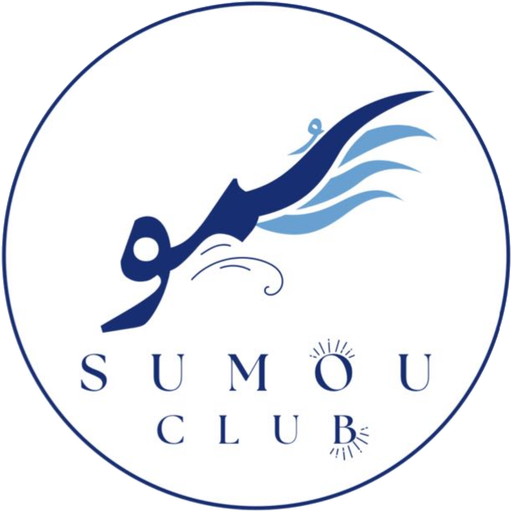

# نادي سمو التطوعي — Sumou Volunteer Club

The official website of **Sumou Volunteer Club** at Prince Mohammad bin Fahd University (PMU).

🔗 **Live site:** https://sumouclub.vercel.app



## Features

- Arabic-first, right-to-left (RTL) layout
- Responsive design for desktop and mobile
- Sections for the club, its values, its teams and upcoming events
- Member registration through a Google Form
- QR codes for the club's Instagram and TikTok accounts
- Contact section with the club's email

## Tech stack

| Area | Tools |
|---|---|
| Front end | HTML, CSS, JavaScript (no framework) |
| Version control | Git and GitHub |
| Hosting | Vercel, with automatic deploys from `main` |

## Project structure

```
index.html        Page content and sections
style.css         Colors, layout and responsive styles
script.js         Mobile menu and scroll animations
logo.png          Club logo
favicon.png       Browser tab icon
qr-*.png          QR codes for social accounts
```

## How updates work

1. Edit a file on GitHub and commit it.
2. Vercel builds and deploys the change automatically.
3. Changes on other branches get a Vercel preview link before they reach the live site.

When `style.css` or `script.js` changes, bump the `?v=` number in `index.html` so browsers load the new version.

## Credits

Built by Mohammed Makrami, Vice President of Sumou Volunteer Club, with AI-assisted development.
